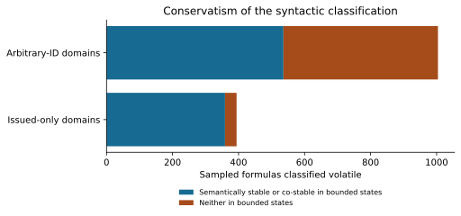
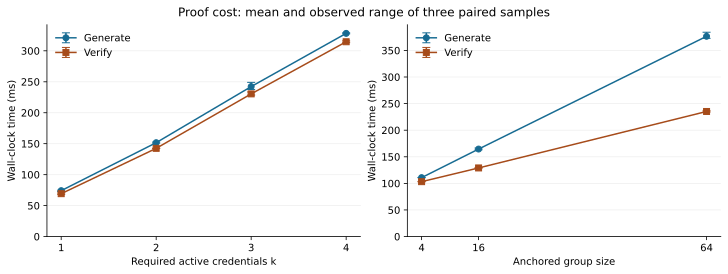
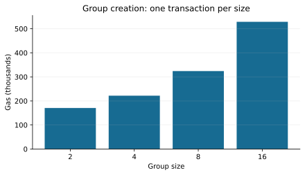
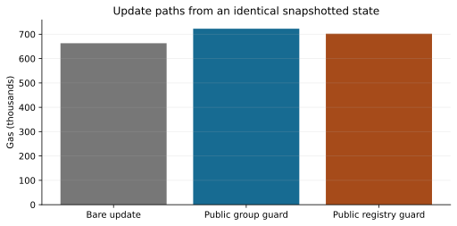

# Evaluation of ledger-enforced public credential guards

Full workload. This evaluation answers four questions about the implemented public-guard subset. It combines functional scenarios, bounded semantic checks and measured proof/EVM costs under the documented trust assumptions.

## Method and provenance

Measurements come from [source revision a2d0cf2](https://github.com/csillag2004/vc-rollup/commit/a2d0cf26823917e767e55532bd240819608fc29e), run on 2026-10-31T19:12:30.916Z. The source worktree was clean. The machine was AMD Ryzen 9 7950X3D 16-Core Processor, 32 logical CPUs, 93.9 GiB RAM, Linux. Proof computations use one Node.js process; this was a shared host with no CPU isolation. Node v26.7.0, Foundry 1.8.6, solc 0.8.30 and the Prague hardfork were used. [Provenance and raw-output hashes](../local/reproduce-provenance.json) specify the exact environment.

Each proof case has one warm-up and three paired generation/verification samples. Tables report mean and observed minimum–maximum, not confidence intervals. Cryptographic keys, IDs and blinding are fresh OS randomness. Formula sampling uses seed 2026, depth at most four, and a universe of four IDs. Every comparable state pair is enumerated for each sampled formula; the formula space itself is not exhaustively enumerated.

## RQ1: Does ledger evaluation prevent the demonstrated false-guard update?

**Yes for the tested public reservation policy and interleaving.** Alice and Bob obtain valid guards at the same state. The naive updater checks both and later revokes both credentials, yielding two reservations. With the policy bound to the action, Alice's update succeeds and Bob's update reverts with `GuardFalse`. Bob's old presentation remains cryptographically valid but is no longer fresh. The reservation's stable "flat is taken" proof remains valid after later issuance. A separate fixture verifies a stable proof after actual later issuance and revocation in that proof's registry. A separate holder proof verifies signature, group membership and revoked status without naming the group member in the proof interface.

The result is a controlled sequential interleaving of a check/use race, not a throughput or many-client concurrency experiment. It does not establish end-to-end anonymity. The contract evaluates the registered public program at execution. A bound update policy cannot be removed or replaced. Unsupported private presented guards are rejected on binding and execution, rather than accepted on the strength of a hash or retrospective proof check. The event proof is available for independent audit, but public guard truth is determined by ledger counters. Policy authors choose the initial program; enforcement does not establish that it represents an external agreement or the descriptive query string.

The [correctness cases](../local/correctness.csv), [BDD outcomes](../local/bdd.json) and [reservation trace](../local/reservation.json) record the observations. Robustness evidence covers duplicate issuance, unissued revocation despite a forged quotient witness, invalid group membership, false public guards, policy replacement/removal, unsupported private guards, malformed policy programs and proof-event integrity through the contract, actor and unit suites. [Robustness results](../local/robustness.csv) and [actor integration output](../local/guard-integration.tap) retain the run evidence. This is functional rejection coverage, not a denial-of-service assessment.

## RQ2: Is the classifier sound on the bounded sample, and how conservative is it?

**No classification violations were observed in 6,000 sampled formulas across the two models.** A stable verdict must never turn false along the enumerated state order; a co-stable verdict must never turn true; a state-independent verdict must not change.

- system model (domains hold issued IDs): 359/394 volatile verdicts (91.1%) are semantically stable or co-stable over the enumerated states.
- general model (groups of arbitrary IDs): 536/1004 volatile verdicts (53.4%) are semantically stable or co-stable over the enumerated states.

These conservative verdicts can request stronger off-chain presentation freshness checking than the bounded semantics require. Public update guards are evaluated directly and do not depend on this classifier to establish guard truth. They are not false soundness claims: the syntactic rule deliberately over-approximates volatility. The percentages describe this generator and finite state space, not a representative production workload or a measured transaction-rejection rate. [Raw classification counts](../local/classification.csv).

The separate Lean model provides ideal set-level proofs. The implementation now supplies structural lifecycle checks and actual public guard evaluation. The model is still not a refinement proof of Solidity or the compiler, and no end-to-end cryptographic or privacy proof is inferred from its theorems.

## RQ3: How do proof costs change with the threshold and anchored group size?

For the threshold cases, mean generation time increases at every tested size and mean verification time does not increase monotonically across the tested sizes. For the hidden group-member cases, mean generation time increases at every tested size and mean verification time does not increase monotonically across the tested sizes. The sample ranges show measurement variability. Threshold cases add credential and distinctness evidence; the tables report encoded proof-element sizes separately from computation time.

Threshold cases:

| Active credentials k | Generate ms, mean (range) | Verify ms, mean (range) | Proof-element bytes |
|---:|---:|---:|---:|
| 1 | 151.6 (140.6–158.8) | 290.3 (148.0–548.5) | 1040 |
| 2 | 299.9 (291.7–305.2) | 284.0 (273.6–291.8) | 2224 |
| 3 | 483.1 (462.4–496.4) | 790.1 (647.5–873.3) | 3520 |
| 4 | 782.6 (683.7–916.3) | 653.2 (622.3–712.7) | 4960 |

Hidden group-member cases:

| Group size | Generate ms, mean (range) | Verify ms, mean (range) | Proof-element bytes |
|---:|---:|---:|---:|
| 4 | 221.1 (213.7–228.6) | 256.4 (222.7–277.9) | 1392 |
| 16 | 313.2 (304.2–325.6) | 270.4 (262.0–283.0) | 1392 |
| 64 | 453.5 (425.3–492.6) | 260.0 (259.4–260.6) | 1392 |

"Proof-element bytes" counts compressed group elements and encoded scalars, excluding JSON framing, identifiers, transport headers and fetched registry history. A public query can therefore have zero proof-element bytes while still requiring data and computation. The full table also measures active/revoked credentials, an OR with a simulated branch, same-holder evidence and aggregate receipts. [All paired timing samples](../local/scalability.csv).

Three samples on one shared host support a description of these runs, not a precise latency SLA or an asymptotic complexity claim. Setup, key generation, credential issuance and network history retrieval are outside the timed proof loops. The aggregate-receipt case receives an already computed witness; its generation time is not the cost of constructing that witness. The hidden-member fixtures keep one presented credential and two revocations, but registry history grows with the group, so this is an implementation scaling experiment rather than an isolated group-operation microbenchmark. Larger groups and thresholds beyond the tested range remain unmeasured.

## RQ4: What are the EVM execution and calldata costs?

**Group creation gets more expensive over the tested sizes.** It checks that each public member ID was issued and stores the fixed member list. Storage and per-member checks explain why this path is not constant-cost.

| Group size | Gas | Calldata bytes |
|---:|---:|---:|
| 2 | 170,581 | 196 |
| 4 | 221,779 | 260 |
| 8 | 324,199 | 388 |
| 16 | 529,004 | 644 |

Group creation uses SRS degree 16 for every size shown. Each row above is one transaction, not a repeated-run estimate. The measurements also include registry/SRS setup, 16 issuances and the update variants below.

| Operation | Variant | Gas | Calldata bytes |
|---|---|---:|---:|
| revoke | control: bare update, identical pre-state | 662,963 | 772 |
| guardedRevoke | control: public group guard, identical pre-state | 722,655 | 1,220 |
| guardedRevoke | control: public registry guard, identical pre-state | 702,148 | 1,252 |
| guardedRevoke | permanently bound public group guard | 722,672 | 1,220 |
| guardedIssueUpdate | permanently bound public group guard + public ID | 559,330 | 900 |

The three control rows restore the same Anvil snapshot before revoking the same ID with the same accumulator update. All policies exist before the snapshot. The action is deliberately unbound so that the bare path can execute. This compares total optional public-guard call cost, including policy lookup, public evaluation, proof bytes and events; it does not isolate a single EVM opcode or establish a universal overhead. The permanently bound rows are separate functional measurements.

| Control path | Gas | Difference from bare update |
|---|---:|---:|
| bare update, identical pre-state | 662,963 | +0 |
| public group guard, identical pre-state | 722,655 | +59,692 |
| public registry guard, identical pre-state | 702,148 | +39,185 |

Each control path is measured once. Proof payloads differ between public group and whole-registry queries, and these payload differences are part of the measured call cost. These are public evaluation paths, not the older reduced design's CAS modes.

Calldata bytes include the selector and arguments. These are local Prague gas measurements, not OP Sepolia L1 data fees, currency costs, finality latency or throughput. [Per-transaction gas and calldata](../local/gas.csv).

## Reproduction and scope

`just reproduce` runs the measurements on a fresh local chain and derives this evaluation under `out/evaluation/`. `just figures results/local out/evaluation` derives the text and figures from the committed full run without rerunning the measurements. The renderer verifies every recorded output hash before interpreting the CSVs. Smoke output is marked as reduced and must not replace the full-workload evaluation.

The evidence supports structural lifecycle checks, ledger-enforced public guards under a permanently bound policy, bounded classification checks and the measured proof/EVM costs. Private guard enforcement is not implemented: those update policies fail closed. Off-chain private status proofs retain their trapdoor-holder limitation. The evidence does not establish general classifier soundness from sampling alone, production throughput, full anonymity, or current public-testnet performance. The broader paper evaluation chapter and new live deployment are outside this companion-repository task.
